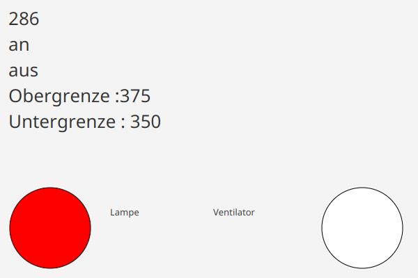

# HeizKuhlen

> **Hinweis:** Das hier ist **nicht das Originalprojekt**, sondern eine **nachträglich überarbeitete Version**.
> Das Original entstand als Studienprojekt im 2. Semester (Netzwerktechnik) unter Windows. Es lief nicht mehr
> und hatte Fehler. Für diese Version wurde es unter Linux wieder lauffähig gemacht, die Fehler wurden behoben,
> und der Server-Emulator sowie die GUI wurden neu gebaut, weil der ursprüngliche Code dafür verloren ist.
> Der unveränderte Originalstand liegt in der Git-Historie (Commit `2b72fd6`).

Zweipunktregler für eine Temperatur: Eine Lampe heizt, ein Ventilator kühlt. Das Programm fragt jede Sekunde
per UDP die Temperatur bei einem Server ab und schaltet:

- über der **Obergrenze** (37,5 °C): Ventilator an, Lampe aus
- unter der **Untergrenze** (35,0 °C): Lampe an, Ventilator aus
- dazwischen bleibt alles, wie es ist



Die GUI zeigt von oben nach unten die Temperatur (in Zehntelgrad), den Zustand der Lampe und des Ventilators
sowie die beiden Grenzen. Die Kreise sind **rot, wenn das Gerät aktiv ist**, sonst weiß.

## Was gegenüber dem Original geändert wurde

- **Fehler im Client behoben:** Die Anfrage wurde nie wirklich gesendet, der Client hing in einer
  Endlosschleife, und die Antwort enthielt ~1000 Null-Bytes, an denen `Integer.parseInt` scheiterte.
- **Lüfter und Heizung schalten wirklich**; vorher war das Schalten teils auskommentiert oder unvollständig.
- **Server-Emulator neu:** Das echte Gerät gibt es nicht mehr, der Emulator ersetzt es. Das Protokoll wurde
  aus dem Client-Code rekonstruiert und kann vom Original abweichen.
- **GUI neu gebaut** nach einem alten Foto der Original-GUI.
- **Unter Linux lauffähig:** JavaFX 21 statt einer Vorabversion von JavaFX 18, `mvnw` ausführbar,
  IntelliJ-Dateien durch VS-Code-Startkonfigurationen ersetzt.

Der ursprüngliche Server liegt noch als `server/UDPTimeServer.java` im Projekt; er beantwortet jede Anfrage
gleich und wird zum Starten nicht gebraucht.

## Starten

Benötigt wird ein JDK ab Version 17. Maven muss nicht installiert sein, `./mvnw` lädt es selbst.

**VS Code:** Im Tab „Ausführen und Debuggen“ **Emulator + GUI** oder **Emulator + Regler** (nur Konsole) wählen.

**Terminal:**

```sh
./mvnw compile
java -cp target/classes server.ServerEmulator      # Terminal 1
./mvnw javafx:run                                  # Terminal 2: GUI
java -cp target/classes MainProgram.Heizen_Kuelen  # oder Terminal 2: nur Konsole
```

## Protokoll (rekonstruiert)

Eine UDP-Nachricht als ASCII-Text an Port 29060:

| Anfrage       | Antwort       | Bedeutung                                              |
|---------------|---------------|--------------------------------------------------------|
| `AE,?`        | `AE,362`      | Temperatur in Zehntelgrad                              |
| `DE,?`        | `DE,hlllllll` | Zustand der 8 Kanäle, `h` = an, `l` = aus              |
| `DA,1xxxxxxx` | `DA,10000000` | Kanäle schalten: `1` = an, `0` = aus, `x` = unverändert |

Kanal 1 ist der Ventilator, Kanal 2 die Lampe. Details stehen in
[ServerEmulator.java](src/main/java/server/ServerEmulator.java).
